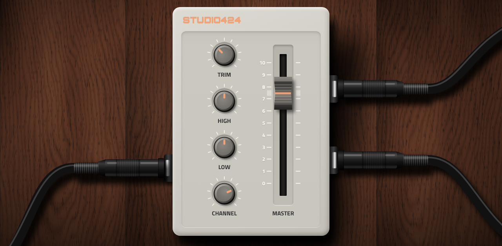

# STUDIO424

A mixer channel strip in a pedal, for Akai MPC standalone hardware, by Lightlike.

STUDIO424 recreates the channel of an early-90s cassette four-track mixer: an input trim into a gently saturating preamp, a two-band shelving EQ, a channel fader, and the mix bus with its master fader. It is the mixer section only, with no tape or noise-reduction model, so it stays clean until you push the trim.



## Signal flow

Trim → preamp stage (soft, slightly asymmetric saturation) → 20 Hz coupling high-pass → High shelf → Low shelf → output-stage soft ceiling (about +9 dBFS) → Channel fader → mix bus summing amp (same soft ceiling) → Master fader. Use the MPC's own insert bypass to switch it off.

## Parameters

| # | Name | Range | Default | What it does |
|---|---|---|---|---|
| 0 | Channel | 0 – 10 | 7.5 | Channel fader (a knob on the pedal). 7.5 = unity, 10 = +10 dB, 5 = −10 dB, 0 = off. |
| 1 | Trim | −10 – +20 dB | 0 dB | Input gain into the preamp. Above about +8 dB the stage starts to colour and compress; at +20 dB it is properly driven. |
| 2 | High | ±10 dB | 0 dB | Shelf at 10 kHz. |
| 3 | Low | ±10 dB | 0 dB | Shelf at 100 Hz. |
| 4 | Master | 0 – 10 | 7.5 | Master fader after the mix bus, same scale as Channel. Push Channel up and Master down to drive the bus. |

Like the original first-generation channel, there is no mid band; later revisions of that mixer added a sweepable mid. Shelf frequencies and ranges follow the published spec. The shelf slope is not published, so it is an estimate (Q 0.55).

## Presets

Flat, Warm Bus, Hot Trim, Vocal Forward, Fat Drums, Thin Lo-Fi.

## Screen and Q-Links

There is one page, **Main**: a column of four knobs (Trim, High, Low, Channel) beside the Master fader. Touch a knob or the fader to bank the Q-Links to it, and double-tap it for the large value editor.

Q-Links, first column top to bottom: Trim, High, Low, Channel. Second column: Master. On an MPC One the first bank is Trim / High / Low / Channel and the second is Master.

The skin is generated by `art/make_skin.py`, which renders the art with headless Google Chrome and writes `skins/TUI.json` and `skins/Q-Links.json`. Re-run it after changing the layout.

## CPU

Three biquads and three `fastTanh` calls per channel per sample. That is a fraction of a percent on a desktop and well inside the MPC budget.

## Build

From the MPC Plugin SDK root:

```
python3 tools/build.py plugins/STUDIO424
python3 tools/package.py plugins/STUDIO424
```

Copy `build/Lightlike - VST - STUDIO424` into a `VST2 Plugins` folder on an MPC drive. You need MPC OS 3.10.1 or later, with External plugins enabled (Preferences → Enhancements (Beta) → Enable Enhancements and External Plugin Support).

## Licence

MIT, see `LICENSE`. The EQ uses the RBJ Audio EQ Cookbook biquads from the SDK's `framework/dsp/biquad.h` (MIT).
